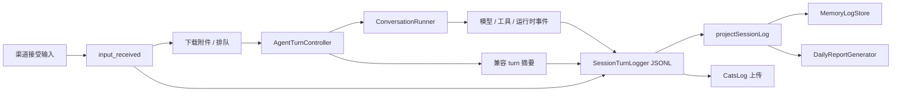

# 会话事件日志与长期记忆

## 目标与数据流

以前的 `turn` 行是成功回合摘要：原始根输入、最终回复和回合结束时提取的工具调用。它不能代表完整会话，尤其会漏掉忙时输入、执行中的多次助手回复以及失败或取消前的进展。

现在采用事件流，并继续输出兼容的成功回合摘要：

职责边界：

- 渠道只登记收到的原始内容和平台身份，将输入 ID 随队列传递。CatsCompany、Feishu、Weixin 在下载附件和排队之前登记；直接调用 `AgentSession.handleMessage` 时在忙状态和后续上下文检查之前补登记。
- `TurnLogRecorder` 将一次执行关联到不可变 `run_id`，记录根输入消费和兼容摘要。
- `ConversationRunner` 在模型响应、工具开始/结束、追加用户输入和模型失败时记录事件，不依赖整轮成功。流式请求失败或重试前保留已收到的文本片段。
- `AIService.chatStream` 使用独立的 `onTextObserved` 回调，在发布缓冲之前观察 provider 文本；执行器据此保留失败或重试片段。界面 `onText` 的发布与重试语义保持独立，观察回调异常不能影响请求。
- `SessionTurnLogger` 负责 JSONL 封装和追加。`session-transcript-content.ts` 负责明确的内容与附件引用序列化，不序列化整个运行时消息对象。
- `projectSessionLog` 是本地记忆和日报共用的语义投影，统一解决原始输入、运行状态、旧格式兼容和重复摘要。

## 事件协议

新行使用 `entry_type: "transcript"`、`schema_version: 1`，包含会话身份、时间戳、`stream_id`、流内递增 `seq` 和 `event_id`。执行事件额外包含 `run_id`。每个日志器实例使用独立流 ID；文件顺序反映追加顺序，不能把不同流的 `seq` 当成全局序号。

| 事件 | 含义 |
| --- | --- |
| `input_received` | 已接受的原始输入，包含独立 `input_id`、来源、平台消息/发送者 ID 和附件引用 |
| `run_started` | 开始执行，包括后续准备阶段可能失败的运行 |
| `input_consumed` | 根输入、追加输入或内部观察被当前运行接纳；批量输入保留全部原始 ID |
| `input_deferred` | 异步队列交接时取消抢先发生，输入没有被消费 |
| `assistant_message` | 模型可见文本或运行时生成的回复；区分 `reply`、`tool_prelude`、`partial`、`runtime_reply` |
| `runtime_observation` | 运行时反馈与合成工具观察，明确区别于用户陈述 |
| `model_failed` | 某次模型调用失败；只记录错误名，不转储可能带敏感数据的异常对象 |
| `tool_started` / `tool_finished` | 工具调用身份、参数和结果；失败结束的运行也保留此前事件 |
| `run_finished` | 运行结束，状态为 `completed`、`failed` 或 `cancelled` |

`model_failed` 与 `run_finished` 的状态是不同事实：已有消息发出后发生后续模型错误，运行可能正常收束。缺少结束事件时，读取投影标为 `unfinished_or_unknown`，不会推断成功或失败。

`assistant_message` 表示生成或保留的文字，不证明平台已送达；投影统一标记 `delivery_unconfirmed`。`runtime_reply` 表示运行时安全提示、轮次预算或空响应兜底，不把这些文字归因给模型。控制器生成的兜底使用 `model_call: 0`。

## 输入、队列与附件

输入收据和执行消费分别登记。排队合并只影响执行用的 `MODEL_INPUT`，原始消息文本、边界和平台 ID 仍可从 `USER_INPUT` 查到。只有收据、没有消费事件的输入可单独检索，并显示 `received; no consumption recorded`；这不是成功交付或持久队列恢复的承诺。

CatsCompany 在云端或分叉恢复之前，通过 `MessageSessionManager` 获取收据记录器，不提前创建空 `AgentSession`。已有会话直接使用自己的日志器；尚未创建会话时暂存日志器，成功创建后交给会话复用。输入收据与执行事件因此保持在同一个文件中，包括恢复跨过午夜或会话持续跨日的情况。未创建会话的记录器随会话 TTL 清理，已落盘的未消费收据保留。

平台 `service_run_receipt` 和子智能体反馈走内部观察入口，构成用户批量合并的边界。Weixin 在上下文令牌状态保存之前写收据，批次 dispatch 成功后才推进持久轮询游标；dispatch 失败时保留旧游标。

CatsCompany 的 pending provider 返回内容、收据 ID 和 `onRejected`。执行器在等待 provider 后再次检查取消；取消时记录推迟并恢复原批次到队首。清空、停止世代改变或关机后不恢复，尊重这些操作的语义。恢复回调幂等。

附件只保存名称、类型、引用及必要的身份信息：

- HTTP(S) URL 和站内绝对路径保留路径，移除用户名、密码、查询和片段；不存签名参数。
- Feishu file key 和转发消息 ID 存在明确的 `reference` 字段中，不伪装成 URL。
- Weixin 收据不接收 AES key 或 `encrypt_query_param`；无安全 URL 时依赖消息 ID、附件顺序、名称和类型。
- 直接输入与工具返回的 base64 图片只记录解码内容 SHA-256 和媒体类型，不记录二进制或 base64。
- 不转储 execution grants、凭据、provider 私有 replay state 或任意运行时对象。工具参数/结果与用户文本本身仍是会话内容，可能包含敏感文本；这里没有承诺对任意文本做通用秘密清洗。

## 本地读取兼容

原始 JSONL 是事实来源。投影按 `event_id` 去重、按运行组合内容，并在事件覆盖成功摘要时避免重复搜索和邻近展示。原始引用仍可直接读取。

| 引用后缀 | 内容 |
| --- | --- |
| `#1`、`#2` | 既有显式 `entry_type: "turn"` 的序号，保持原有编号语义 |
| `#legacy:1` | 更早的无 `entry_type` 回合；不占用显式 turn 的编号 |
| `#run:<id>` | 一次事件运行，包括中间输出、工具、追加输入和结束状态 |
| `#input:<id>` | 一条原始输入收据，包括尚未消费的输入 |

完整引用仍为 `类型/日期/文件.jsonl#后缀`。记忆工具接受上述格式，并保留既有路径约束。

`parseSessionLogContent` 默认严格解析；本地记忆与日报显式启用容错读取，跳过损坏 JSON 行并继续读取有效内容。日报输出损坏行位置诊断。新日志器首次追加前检查文件尾；上一进程留下半行时先补换行，避免后续有效事件粘在坏行后面。

日报扫描 `chat`、`cli`、`catscompany`、`feishu`、`weixin`，个人组包括 Chat/CLI/Weixin，团队组包括 CatsCompany/Feishu。它使用同一投影去重并提取原始用户主题，不把纯内部观察当成用户主题。日报仍是有限摘要，不能替代原始事件和记忆读取。

## 上传确认

v1 客户端自行读取文件，过去在上传后用源文件最新 stat 更新确认点，会把上传期间追加但未发送的尾部误标为已上传。

v1 现在先创建保留原文件名的临时快照，上传该固定文件。确认点的大小与 SHA-256 来自快照，mtime 来自复制前的源文件。服务端如果返回 SHA-256，必须与快照一致；失败、拒绝状态或哈希不一致均不推进确认点。临时快照在成功和失败时清理。上传期间新增的尾部留待下一周期。

v2 同样在请求前固定待确认的前缀哈希：从已验证的前缀和实际发出的 chunk 计算，收到确认后不再重读源文件。上传期间同长度改写或替换不会被误认为已同步；下一周期通过前缀校验触发协调。

v1 仍按整个快照重传前缀，每个并发上传多占一份临时磁盘空间。v2 offset/hash/newline 协议保持兼容。既有过滤策略也不变：会话目录范围、检查员排除、稳定等待、周期/并发/数量限制以及 v1 大小上限。持续活跃文件可能长期等不到稳定窗口；v1 超大文件仍会被跳过。这些是延迟或策略排除，不能从本次修复推断所有文件都会立即远端可用。

## 采用与边界

- 新版本自动在原会话 JSONL 中追加事件；不需要重写旧文件，保留 `turn` 兼容摘要。回滚后的旧客户端仍能依靠原摘要，但不会获得新事件的完整历史。
- 本地记忆与日报已支持新事件。CatsLog 远端抽取/索引服务是否理解事件协议仍需在对应服务确认；原始文件上传成功不等于远端长期记忆已完整。
- 历史未写下的排队输入或中间回复无法由旧摘要重建；如需回补，必须取得原平台历史等真实来源，且应单独设计幂等迁移。
- 日志追加是尽力而为。磁盘错误不能阻断用户会话；没有队列事务、fsync 保证或进程重启后的自动重放。硬崩溃、磁盘失败及排队后清空仍可能导致未执行或缺失；未知结束状态被明确保留。
- 独立子智能体有自己的执行边界；父会话保留子任务反馈与最终观察，本次不保证完整收集子智能体内部每次模型与工具交互。分支日志也不自动成为会话上传文件。
- 既有命令/被动确认/回声过滤与工具 transcript 规则继续生效；事件流不是原始网络抓包或所有 provider 请求的归档。
- 工具结果默认完整；显式设置 `XIAOBA_SESSION_TOOL_RESULT_LIMIT` 时仍截断并标注。旧摘要 runtime feedback 使用既有 `XIAOBA_SESSION_RUNTIME_FEEDBACK_LIMIT`（默认 4000）；独立 runtime observation 事件保留完整文本。
- 记忆读取仍有字符预算和搜索条数限制；被截断的单次读取不代表原日志不存在后续内容。

## 验证

回归测试使用合成输入、假模型/工具、隔离 home/tmp 与空 dotenv，不读取真实用户日志或凭据，也不调用外部模型。上传 HTTP fixture 仅使用本地测试服务。

重点用例在 `tests/session-transcript.test.ts`、渠道 route/execution-flow 测试、`tests/catsco-log-upload-scheduler.test.ts` 和 `tests/daily-report-generator.test.ts`：覆盖追加输入、中间回复、流式失败/取消、队列交接恢复、附件字段、旧引用、损坏尾行、重复摘要抑制、日报渠道与上传过程中追加尾部。
